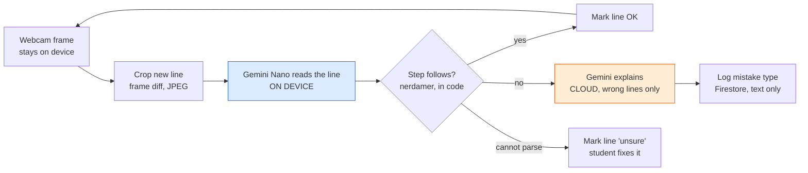

# Rough Work

Rough Work watches you solve maths on paper and flags the first wrong line while you write.

Point a webcam at your notebook and write your steps as usual. When a line does not follow from your last correct line, Rough Work marks it red. Then it explains the mistake in Hinglish, with three hints. You find the sign error on line 3 right after you write it, not 20 minutes later at the answer key.

Built for #BuildHybridAI 2026 with Firebase AI Logic and Gemini Nano in Chrome.

**Live demo:** <https://rough-work-81b7f.web.app> (not deployed yet).

**Judges:** see [docs/TESTING.md](docs/TESTING.md).

## How it works

The device reads every line. Code judges every line. The cloud speaks only when a line is wrong.

This is the normal mode, with Gemini Nano on the device. Without Nano, the app runs in cloud mode (see the routing rules).



1. **Capture.** The app compares webcam frames on a canvas, inside a guide box that you fit to your page. When you pause after a new line, it crops only that line to a JPEG. Press **Space** to send a line at once.
2. **Read on device.** Gemini Nano reads the crop and returns JSON: `{latex, plain, confidence}`.
3. **Check in code.** A step checker compares the new line with the last correct line. It tests values at sample points, and for equations it compares solution sets; [nerdamer](https://nerdamer.com/) parses the maths and is a backup check. A partial answer (one root of two) is accepted. The language model only reads handwriting. It does not decide right or wrong.
4. **Explain in the cloud.** Only for a wrong step, the cloud Gemini model gets the two lines (text and crops). It returns a Hinglish explanation, an English version, a hint ladder (nudge, method, answer) and a mistake type.
5. **Log.** Firestore stores the mistake as text. The **My mistakes** page lists your recent mistakes, and the most common mistake types across all users.

You can click any line to fix what was read (the fix-it edit). The app checks the line again, and the line after it.

## How Firebase AI Logic is used

| File | What it does |
|---|---|
| [src/firebase.ts](src/firebase.ts) | Initializes Firebase, App Check (reCAPTCHA Enterprise) and `getAI` with the Gemini Developer API backend. Creates the read model with `InferenceMode.PREFER_ON_DEVICE` and a cloud model with `InferenceMode.ONLY_IN_CLOUD`. |
| [src/read.ts](src/read.ts) | `readLine()` sends one line crop to the hybrid model with a JSON schema and records where it ran (device or cloud). `readLineInCloud()` re-reads a crop in the cloud. `initDeviceModel()` downloads Nano and reports progress. |
| [src/explain.ts](src/explain.ts) | `explainMistake()` calls the cloud model (`ONLY_IN_CLOUD`) with both lines and their crops. It returns structured JSON: Hinglish and English text, 3 hints and a mistake type from a fixed list. |

The routing between them is in [src/pipeline.ts](src/pipeline.ts).

## Routing rules

1. Read each line with `PREFER_ON_DEVICE`. If Nano is not available, the app reads in the cloud, waits at least 20 s between cloud reads, and shows a **cloud mode** badge.
2. If Nano's confidence is below the threshold (default 0.6), re-read that crop once in the cloud.
3. Before a line turns red, Nano reads the crop a second time. If the two reads disagree, the line is marked **unsure** (amber), not wrong. The second read is skipped in cloud mode and for lines you fixed by hand.
4. If nerdamer cannot parse a line, mark it **unsure**. Do not call the cloud.
5. A wrong step calls the cloud for the explanation. The cloud gets both lines: the wrong line and the last correct line, as text and crops.
6. A daily cap (default 50) limits cloud calls per user. At the cap:
   - a wrong step stays red, with "No explanation yet (offline or daily limit)",
   - a low-confidence device read is not re-read in the cloud; the device result is checked as usual,
   - in cloud mode, new lines become **unsure**, and you can fix them by hand.

## Why hybrid

| Reason | Detail |
|---|---|
| Cost | A 2-hour session can have hundreds of line reads. On the device, they cost nothing. The cloud runs only for the few wrong lines. |
| Latency | The wrong-step flag needs no network round trip. |
| Privacy | The camera sees a minor's room. Full frames never leave the device. With Nano, line crops leave the device only for a wrong step (that line and the last correct line) or a low-confidence read (that line). |
| Bad Wi-Fi | Hostel Wi-Fi drops. With Nano, reading and checking work with Wi-Fi off. Only the explanation needs the network. |

## Hybrid meter

The top bar shows `on-device reads: N · cloud calls: M · ratio N:1` for the current problem. Each line has a badge: **device**, **cloud**, or **typed** (demo lines). The goal is at least 20 device reads for each cloud call.

## Privacy

- No webcam frame is stored, on the device or in the cloud.
- Line crops stay in memory. A crop goes to the cloud only in these cases:
  - the step is wrong: the wrong line and the last correct line go to the cloud for the explanation,
  - the device read has low confidence: that line goes for one cloud re-read,
  - the app is in cloud mode because Nano is not available. Then every line crop goes to the cloud for reading. The **cloud mode** badge shows this.
- Firestore stores text only, under your anonymous user ID:
  - each session: the problem text you type, the start time, the line count, and the device and cloud counts,
  - each explained mistake: the mistake type, the two transcribed lines and the explanation.
- Firestore also keeps a shared count per mistake type (`mistakeTypes/{type}`). Every signed-in user can read these counts. They hold no user ID and no lines.
- Sign-in is Anonymous Auth. The app asks for no name, email or phone number.

## Measured numbers

First measurements, Chrome 158, typed-font test images. Real handwriting is not measured yet.

| Measure | Result | Target |
|---|---|---|
| Nano read, warm | about 2 s (1.9 to 2.4 s) per read | |
| Nano read, first call (cold) | 19.7 s | one time per page load |
| Cloud read | 4.3 s | cloud mode only |
| Time to flag a wrong step | not measured yet; a red flag needs two Nano reads, so expect about 4 s or more | under 3 s |
| Cloud explanation | 1.6 to 2.4 s (median 2.0 s, 5 runs) | under 5 s |
| Handwriting accuracy | pending | 14 of 20 neat lines |

## Tech stack

| Part | Choice |
|---|---|
| Frontend | Vite, React 19, TypeScript, single-page app |
| AI | Firebase AI Logic (`firebase/ai`): Gemini Nano on device, Gemini Developer API in the cloud (default model `gemini-3.5-flash-lite`) |
| Maths check | nerdamer (JavaScript computer algebra) |
| Camera | `getUserMedia`, canvas frame diff, JPEG crop |
| Backend | Firebase Anonymous Auth, Firestore, Remote Config, App Check (reCAPTCHA Enterprise), Hosting |
| Voice | Browser `speechSynthesis` reads the explanation aloud |

## Setup

### Requirements

- Chrome desktop 139 or later.
- 16 GB RAM, or a GPU with more than 4 GB VRAM.
- About 22 GB free disk space for the Nano model.
- Node.js 20 or later.

### 1. Turn on Gemini Nano in Chrome

1. Open `chrome://flags/#prompt-api-for-gemini-nano-multimodal-input`.
2. Set the flag to **Enabled**.
3. Restart Chrome.
4. Open the `/spike` page and click the download button. Wait for 100%. The download is large and can take a long time.

Until the model is downloaded, the practice page runs in cloud mode.

### 2. Create the Firebase project

Follow [docs/SETUP.md](docs/SETUP.md), a click-by-click checklist for the Firebase console.

### 3. Configure and run

```sh
npm install
cp .env.example .env.local
npm run dev
```

Fill in `.env.local` with the values from your Firebase web app and the reCAPTCHA Enterprise site key. Never commit `.env.local`. It is in `.gitignore`. Put your Firebase project ID in `.firebaserc`.

Without `.env.local`, the app still starts. Demo mode and the step checker work. Reading, explanations and the mistake log need Firebase.

### App Check debug token (local development)

App Check blocks requests from `localhost` unless you register a debug token.

1. Set `VITE_APPCHECK_DEBUG_TOKEN=true` in `.env.local`.
2. Run `npm run dev` and open the app. The browser console prints `App Check debug token: <token>`.
3. Register the token in the Firebase console. See [docs/SETUP.md](docs/SETUP.md), step 8.
4. Replace `true` with the token in `.env.local`.

The debug token is a secret. Do not commit it or share it.

## Remote Config

If Remote Config is not available or a value is not valid, the app uses the local default in [src/config.ts](src/config.ts).

| Parameter | Default | Use |
|---|---|---|
| `cloud_frame_interval_ms` | 20000 | Minimum gap between cloud reads in cloud mode |
| `confidence_threshold` | 0.6 | Below this, re-read the line in the cloud |
| `daily_cloud_cap` | 50 | Cloud calls per user per day |
| `read_prompt` | see `src/config.ts` | Base read prompt. `read.ts` appends the JSON format rules. |
| `explain_prompt` | see `src/config.ts` | Base explain prompt. `explain.ts` appends the JSON fields and mistake types. |
| `cloud_model` | `gemini-3.5-flash-lite` | Cloud Gemini model |
| `frame_interval_ms` | 8000 | Not used for reading: lines are read when the detector sees a finished line, not on a timer. It is the lower limit for `cloud_frame_interval_ms`. |

## Deploy

Use the Firebase CLI through `npx`. You do not need a global install.

```sh
npx firebase-tools@15.37.0 login
npm run build
npx firebase-tools@15.37.0 deploy
```

This deploys Hosting (from `dist/`), Firestore rules and indexes, and the Remote Config template (`remoteconfig.template.json`). Deploying `remoteconfig` replaces the template in the console.

After the deploy, check that `<project-id>.web.app` is in the reCAPTCHA Enterprise key's allowed domains.

## How to test

- Automated tests: `npm test`.
- Judges and manual tests, including the Wi-Fi off test: [docs/TESTING.md](docs/TESTING.md).
- Nano accuracy: open `/spike`, upload photos of single handwritten lines, type the expected answer for each, and read the accuracy score.

## License

[Apache License 2.0](LICENSE).
