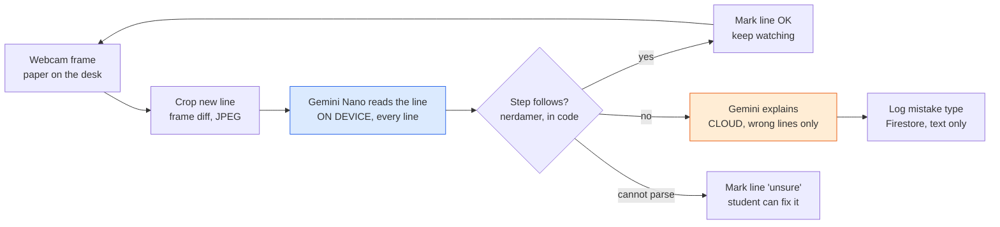

# Rough Work

Rough Work watches you solve maths on paper and flags the first wrong line while you write.

Point a webcam at your notebook. Write your steps as usual. When a line does not follow from the line before it, Rough Work marks it red within about 3 seconds and explains the mistake in Hinglish. You find the sign error on line 3, not 20 minutes later at the answer key.

Built for #BuildHybridAI 2026 with Firebase AI Logic and Gemini Nano in Chrome.

## How it works

The device reads every line. Code judges every line. The cloud speaks only when a line is wrong.

This is the normal mode, with Gemini Nano on the device. Without Nano, the app runs in cloud mode (see the routing rules below).



1. **Capture.** The app compares webcam frames on a canvas. When a new line of writing appears, it crops only that line to a JPEG.
2. **Read on device.** Gemini Nano reads the crop through Firebase AI Logic (`InferenceMode.PREFER_ON_DEVICE`). It returns JSON: `{latex, plain, confidence}`.
3. **Check in code.** [nerdamer](https://nerdamer.com/) tests whether the new line is equivalent to the line before it. The verdict is deterministic. The language model only reads handwriting; it does not decide right or wrong.
4. **Explain in the cloud.** Only when a step is wrong, the cloud Gemini model (`InferenceMode.ONLY_IN_CLOUD`) gets the two lines. It returns a Hinglish explanation, a 3-step hint ladder (nudge, method, answer) and a mistake type.
5. **Log.** Firestore stores the mistake type as text. The "My mistakes" page shows your repeated mistakes.

Routing rules:

- If Nano is not available, the app reads in the cloud at a slower interval (20 s instead of 8 s) and shows a "cloud mode" badge.
- If Nano's confidence is below the threshold (default 0.6), the app re-reads that crop once in the cloud.
- If nerdamer cannot parse a line, the line is marked "unsure" (amber). The app does not call the cloud for parse failures.
- A daily cap (default 50) limits cloud calls per user.

## Why hybrid

| Reason | Detail |
|---|---|
| Cost | A 2-hour session has about 900 line reads. On device, they cost nothing. The cloud runs only for the few wrong lines. |
| Latency | A wrong step is flagged in under 3 seconds with no network round trip. |
| Privacy | The camera sees a minor's room. Full frames never leave the device. With Nano, a line crop leaves the device only when a step is wrong or a read is unsure. In cloud mode (no Nano), every line crop goes to the cloud. |
| Bad Wi-Fi | Hostel Wi-Fi drops. With Nano on the device, reading and checking work with Wi-Fi off. Only the explanation needs the network. Without Nano, reading needs the network too. |

## The hybrid meter

The practice screen shows a live counter, for example `on-device reads: 47 · cloud calls: 2`. Each line has a badge that shows where it was read: device or cloud. The target is at least 20 device reads for each cloud call.

## Privacy

- No webcam frame is stored. Not on the device, not in the cloud.
- Line crops stay in memory. A crop goes to the cloud in these cases only:
  - the step is wrong (for the explanation),
  - the on-device read has low confidence (one cloud re-read),
  - the app is in cloud mode because Nano is not available. Then every line crop goes to the cloud for reading. The "cloud mode" badge shows this.
- Full webcam frames never leave the device.
- Firestore stores text only: session counts and mistake types with the two transcribed lines.
- Sign-in is Anonymous Auth. The app asks for no name, email or phone number.

## Tech stack

| Part | Choice |
|---|---|
| Frontend | Vite, React 19, TypeScript, single-page app |
| AI | Firebase AI Logic (`firebase/ai`): Gemini Nano on device, Gemini Developer API in the cloud (default model `gemini-3.5-flash-lite`) |
| Maths check | nerdamer (JavaScript computer algebra) |
| Camera | `getUserMedia`, canvas frame diff, JPEG crop |
| Backend | Firebase Anonymous Auth, Firestore, Remote Config, App Check (reCAPTCHA Enterprise), Hosting |
| Voice | Browser `speechSynthesis` |

## Setup

### Requirements

- Chrome desktop 139 or later.
- 16 GB RAM, or a GPU with more than 4 GB VRAM.
- About 22 GB free disk space for the Nano model.
- Node.js 20 or later.

### 1. Turn on Gemini Nano in Chrome

1. Open `chrome://flags/#prompt-api-for-gemini-nano-multimodal-input`.
2. Set the flag to **Enabled**.
3. Restart Chrome.

The first on-device read starts the Nano model download. Open the `/spike` page and click the download button to start it early. The download can take a long time.

### 2. Create the Firebase project

Follow [docs/SETUP.md](docs/SETUP.md). It is a click-by-click checklist for the Firebase console.

### 3. Configure the app

```sh
npm install
cp .env.example .env.local
```

Fill in `.env.local` with the values from your Firebase web app and the reCAPTCHA Enterprise site key. Never commit `.env.local`. It is in `.gitignore`.

Put your Firebase project ID in `.firebaserc`. Replace `rough-work-REPLACE_ME`.

### 4. Run

```sh
npm run dev
```

Open the URL that Vite prints, in Chrome.

### App Check debug token (local development)

App Check blocks requests from `localhost` unless you register a debug token.

1. Set `VITE_APPCHECK_DEBUG_TOKEN=true` in `.env.local`.
2. Run `npm run dev` and open the app. The browser console prints `App Check debug token: <token>`.
3. In the Firebase console, register this token. See [docs/SETUP.md](docs/SETUP.md), step 8.
4. Replace `true` with the token in `.env.local`, so the token stays the same across browser profiles.

The debug token is a secret. Do not commit it or share it.

## Remote Config

The app reads these values from Remote Config. If Remote Config is not available or a value is not valid, the app uses the local default in [src/config.ts](src/config.ts).

| Parameter | Default | Valid range |
|---|---|---|
| `frame_interval_ms` | 8000 | Integer, 2000 to 120000 |
| `cloud_frame_interval_ms` | 20000 | Integer, 2000 to 600000, never below `frame_interval_ms` |
| `confidence_threshold` | 0.6 | 0 to 1 |
| `daily_cloud_cap` | 50 | Integer, 0 to 10000 |
| `read_prompt` | see `src/config.ts` | Non-empty text. `read.ts` appends the JSON format rules. |
| `explain_prompt` | see `src/config.ts` | Non-empty text. `explain.ts` appends the JSON fields and the allowed mistake types. |
| `cloud_model` | `gemini-3.5-flash-lite` | A Gemini model name |

The app fetches new values at most once per hour in production and once per minute in development. A fetch that takes more than 3 seconds is skipped.

## Deploy

Use the Firebase CLI through `npx`. You do not need a global install.

```sh
npx firebase-tools@15.37.0 login
npm run build
npx firebase-tools@15.37.0 deploy
```

This deploys Hosting (from `dist/`), Firestore rules and indexes, and the Remote Config template (`remoteconfig.template.json`).

To deploy one part only:

```sh
npx firebase-tools@15.37.0 deploy --only hosting
npx firebase-tools@15.37.0 deploy --only firestore
npx firebase-tools@15.37.0 deploy --only remoteconfig
```

Note: `firestore.rules` and `firestore.indexes.json` must exist before you deploy Firestore. If they are missing, `deploy` and `deploy --only firestore` fail. Use `--only hosting,remoteconfig` until they exist.

Note: deploying `remoteconfig` replaces the template in the console. If you changed values in the console, update `remoteconfig.template.json` first.

After the deploy, add the Hosting domain (`<project-id>.web.app`) to the reCAPTCHA Enterprise key's allowed domains.

## How to test

### Automated tests

```sh
npm test
```

### Spike page: Nano reading accuracy

1. Open `/spike`.
2. Click the button to download the on-device model. Wait for 100%.
3. Choose photos of single handwritten lines (JPEG or PNG).
4. For each row, type the expected answer. The page shows where each read ran (device or cloud) and the accuracy score.

Target: at least 14 of 20 neat lines read correctly.

### Practice page: the full loop

1. Open `/practice`. Allow camera access.
2. Put the page inside the guide box.
3. Write a problem, then the steps, one line at a time. For example:
   - `2(x + 3) = 10`
   - `2x + 6 = 10`
   - `2x = 16` (wrong on purpose)
4. Check: the third line turns red, and a Hinglish explanation appears in under 5 seconds.
5. Check: the hybrid meter shows more device reads than cloud calls.
6. Open `/mistakes`. Check that the mistake type is in the list.

### Wi-Fi off test

This test needs Gemini Nano on the device (Chrome flag on, model downloaded). In cloud mode, reading needs the network.

1. Open `/practice` and let the page load fully.
2. Turn Wi-Fi off.
3. Write two correct lines, then one wrong line.
4. Check: each line is read with a "device" badge, and the wrong line turns red in under 3 seconds.
5. Turn Wi-Fi on. Write one more wrong line. Check: the explanation appears. Explanations need the network; reading and checking do not.

## License

[Apache License 2.0](LICENSE).
